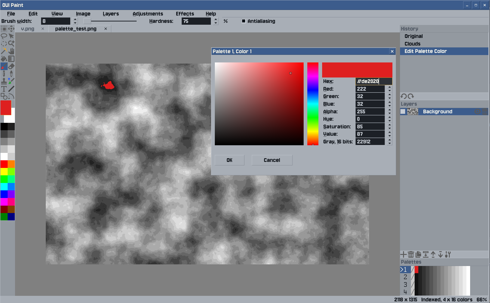

# OUI Paint



A raster image editor in the spirit of Paint.NET, built on OUI: layers, selections that can be moved, turned and
scaled, Paint.NET's tools, effects and keys, 8 and 16 bits per channel, indexed images with palettes, OpenRaster,
the system clipboard both ways, and plugins in JavaScript. See [PLAN.md](PLAN.md), the keys in
[doc/shortcuts.md](doc/shortcuts.md) and how to write plugins in [doc/plugins.md](doc/plugins.md).

## Install

OUI Paint, ready to run. One line in a terminal, for your system:

**Linux and macOS**

```sh
curl -fsSL https://raw.githubusercontent.com/iganinja/oui_paint/master/install.sh | sh
```

**Windows**, in PowerShell

```powershell
irm https://raw.githubusercontent.com/iganinja/oui_paint/master/install.ps1 | iex
```

**Debian, Ubuntu and the like**, kept up to date by `apt upgrade` and in the desktop's menu

```sh
curl -fsSL https://raw.githubusercontent.com/iganinja/oui_paint/master/install.sh | sh -s -- --apt
```

Or download it from the [releases](https://github.com/iganinja/oui_paint/releases).

The installers show what there is and ask, then download it, check it against the release's sums and install it, with
no root and no administrator but for `--apt`: in `~/.local/bin` on Linux and macOS, and on Windows in
`%LOCALAPPDATA%\Programs\oui_paint`, which they add to the PATH, with a shortcut in the Start menu. There are programs
for Linux and Windows on x86-64, for Linux on 64-bit ARM, and for macOS on Apple's processors and Intel's. On Linux it
needs glibc 2.35 or newer, as Ubuntu 22.04 and Debian 12 have.

## Building

OUI comes as a git submodule:

```sh
git clone --recurse-submodules https://github.com/iganinja/oui_paint.git
```

Linux and macOS, with CMake, Ninja, a C++17 compiler and GoogleTest (`libgtest-dev`, or `brew install googletest`):

```sh
tools/build.sh    # builds in build/ and runs the tests
bin/oui_paint
```

Copying and pasting images uses `wl-copy` and `wl-paste` on Wayland, `xclip` on X11.

Windows, cross-built on Linux with llvm-mingw, which the script fetches once:

```sh
tools/build_windows.sh            # dist/oui_paint.exe, needing nothing installed beside it
tools/build_windows.sh --tests    # also dist/oui_paint_tests.exe, to run on Windows or with wine
```

A release is made by pushing a version's tag, as `v0.1.0`: GitHub's release workflow tests it, builds it for each
system with `tools/build_portable.sh`, publishes the files `tools/package_release.sh` makes of them, and puts the
Debian packages in the APT repository on GitHub Pages.

## License

zlib, as OUI. Third-party pieces and their licenses are listed in [THIRD_PARTY.md](THIRD_PARTY.md).
